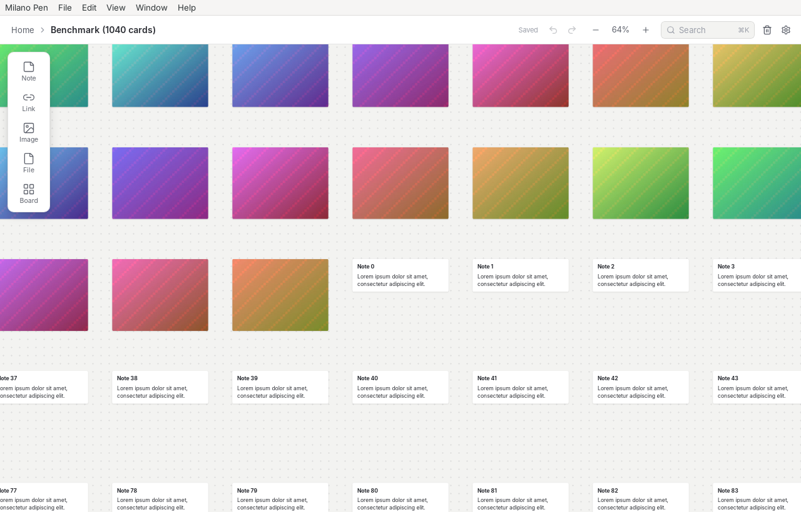
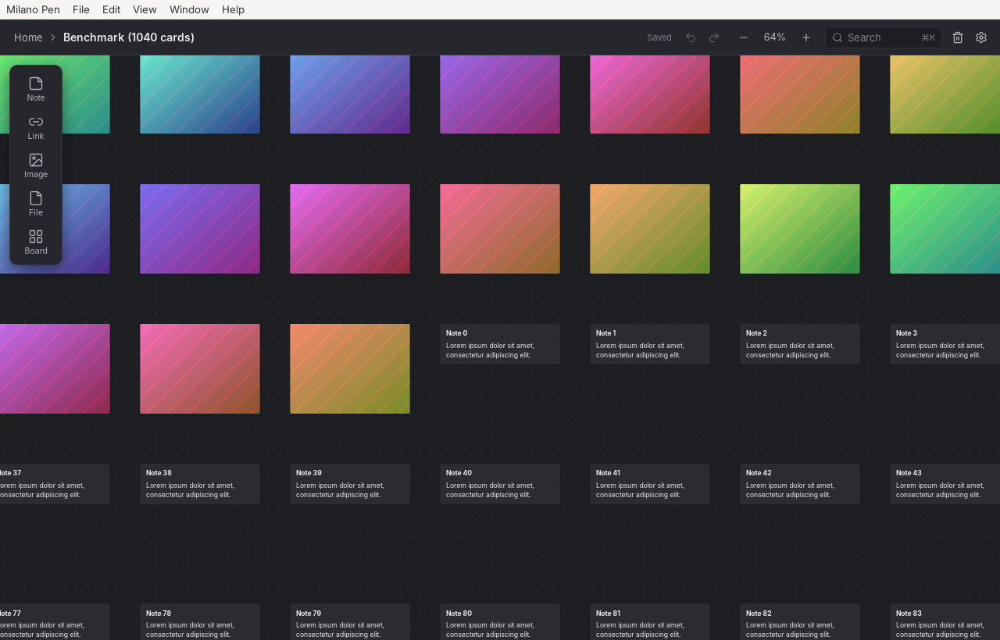
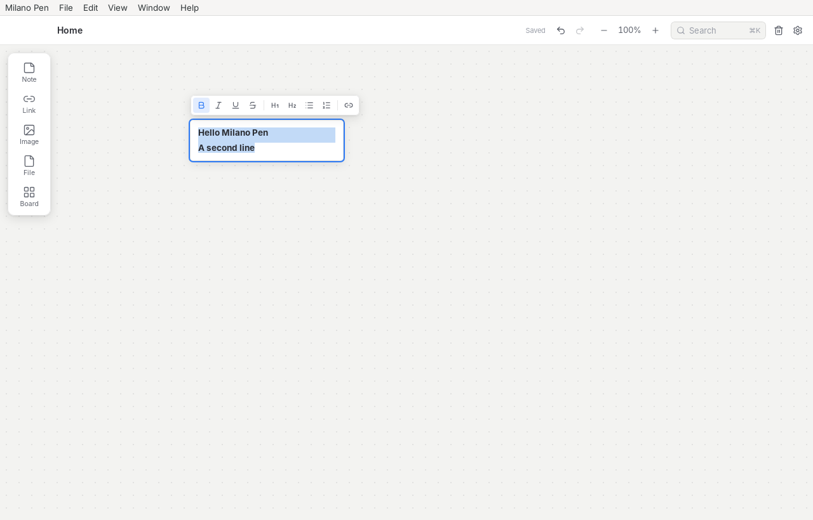

<p align="center">
  
</p>

<h1 align="center">Milano Pen</h1>

<p align="center">
  A free, open-source, local-first visual workspace for macOS.<br>
  Notes, images, files, links and boards on an infinite canvas — stored on your Mac, nowhere else.
</p>

<p align="center">
  <a href="https://github.com/pauldelacv/milano-pen/actions/workflows/ci.yml"></a>
  <a href="LICENSE"></a>
</p>



| Dark mode | Editing a note |
| :---: | :---: |
|  |  |

<sub>Screenshots from the development build on Linux (the benchmark board); on macOS the menu lives in the system menu bar and the window has native traffic lights.</sub>

Milano Pen is a native macOS application (Tauri 2 + Rust + React) inspired by
the way [Milanote](https://milanote.com) lets you think visually. It has no
account, no cloud, no telemetry and no server: your boards live in a SQLite
database and an asset folder in `~/Library/Application Support/Milano Pen`.

> [!NOTE]
> Milano Pen is young (version 0.1). Milestone 1 is complete and several
> Milestone 2–4 features are already in; see [what works today](#features) and
> the [roadmap](docs/ROADMAP.md). It is an independent project, not affiliated
> with Milanote.

## Features

**Canvas** — infinite board, smooth pan and zoom (trackpad, pinch, ⌘-scroll,
optional wheel zoom), Space-drag and middle-drag panning, drag and resize,
multi-selection and selection rectangle, snap to grid (⌥ to place freely),
bring to front / send to back, copy / cut / paste / duplicate, arrow-key
nudging, context menus, zoom to fit. Only the cards in view are mounted, so
boards with thousands of cards stay responsive.

**Cards**
- **Notes** with rich text: bold, italic, underline, strikethrough, headings,
  lists, links, three text sizes, twelve background colours.
- **Images**: add from the toolbar, drop from Finder or paste from the
  clipboard (JPEG, PNG, GIF, WebP, HEIC, TIFF, BMP, SVG…). Thumbnails are
  generated in the background; originals are never modified. Captions, resize
  with locked aspect ratio, full-screen viewer with ←/→ navigation.
- **Files**: any file as an attachment card with its name, type and size;
  open it with its default app or reveal it in Finder.
- **Links**: paste a URL to get a link card; YouTube, Vimeo and Spotify links
  play inline. Nothing is fetched behind your back.
- **Boards**: nested boards with icons, colours and card counts, breadcrumb
  navigation.

**Organisation** — global search (⌘K), Trash with restore and permanent
deletion, undo/redo for every change, Markdown and JSON export of a board, JSON
import, database backup and restore, automatic daily backups, light and dark
mode following macOS.

**Native Mac app** — macOS menu bar with standard shortcuts, native file
dialogs, Finder drag and drop, Apple Silicon and Intel builds, DMG installer.

Not there yet (planned, see the [roadmap](docs/ROADMAP.md)): to-do lists,
columns, documents, tables, sketches, lines and arrows, comments, colour
swatches, labels, templates, the cross-board task view and Milanote import.
Cards of those kinds that already exist in a database are preserved and shown
as "not supported yet", never dropped.

## Install on macOS

1. Download the DMG for your Mac from the
   [latest release](https://github.com/pauldelacv/milano-pen/releases):
   `…_arm64.dmg` for Apple Silicon (M1 and later), `…_x64.dmg` for Intel.
2. Open the DMG and drag **Milano Pen** to **Applications**.
3. Open it from Applications or Launchpad.

> [!IMPORTANT]
> **Unsigned builds and Gatekeeper.** Until the project has an Apple Developer
> ID, release builds are *not* signed with a Developer ID and *not* notarized
> (each release's notes say which). macOS will then refuse the first launch
> with a message such as "Milano Pen can't be opened" or "Apple could not
> verify…". To open it anyway: right-click the app → **Open** → **Open**, or
> go to **System Settings → Privacy & Security** and click **Open Anyway**.
> Only do this for builds downloaded from this repository's Releases page, and
> check the file against `SHA256SUMS.txt` (`shasum -a 256 -c SHA256SUMS.txt`).

Requirements: macOS 11 Big Sur or later.

## Your data

| What | Where |
| --- | --- |
| Database | `~/Library/Application Support/Milano Pen/database/milano-pen.sqlite` |
| Imported files (originals) | `…/Milano Pen/assets/` |
| Thumbnails (regenerated if deleted) | `…/Milano Pen/thumbnails/` |
| Automatic backups (daily, last 10) | `…/Milano Pen/backups/` |
| Projects (File → New Project…) | wherever you save them: a `Name.milanopen` folder with the same layout |

**File → Back Up Database…** writes a consistent copy anywhere you like;
**File → Restore from Backup…** validates a backup and swaps it in (your
current database is saved to `backups/` first). **File → Export Board as
Markdown/JSON…** exports the current board.

## Development

### Prerequisites

- macOS 11+ with Xcode Command Line Tools (`xcode-select --install`)
- [Rust](https://rustup.rs) — the exact version is pinned in `rust-toolchain.toml` and installed automatically
- Node.js 22 (see `.nvmrc`) and npm

Linux works for development too (install
[Tauri's Linux prerequisites](https://v2.tauri.app/start/prerequisites/)).

### Run it

```bash
npm install
npm run app:dev        # starts Vite and the Tauri app with hot reload
```

Development uses your real data folder unless you point it elsewhere:

```bash
MILANO_PEN_DATA_DIR="$PWD/.milano-dev-data" npm run app:dev
```

### Build a Mac app locally

```bash
npm run app:build                                   # .app and .dmg for this Mac
npm run tauri -- build --target x86_64-apple-darwin # Intel build from Apple Silicon
                                                    # (rustup target add x86_64-apple-darwin first)
```

The bundles land in `target/<target>/release/bundle/{macos,dmg}/`. Local
builds are unsigned; see [docs/RELEASING.md](docs/RELEASING.md) for signing.

### Tests and checks

```bash
npm run lint && npm run typecheck && npm test        # frontend: ESLint, tsc, Vitest
cargo fmt --all --check
cargo clippy --workspace --all-targets -- -D warnings
cargo test --workspace                               # Rust core + commands
```

`cargo test` includes a large-board test (1,000+ cards, 300 images) that
checks loading and undo stay fast. In the app, **Help → Generate Benchmark
Board** builds the same board for manual performance testing; see
[docs/PERFORMANCE.md](docs/PERFORMANCE.md).

## Architecture

```
src/                 React + TypeScript UI (canvas, cards, editors, stores, services)
src-tauri/           Tauri shell: IPC commands, native menu, milano:// asset protocol
crates/milano-core/  Rust core: SQLite + migrations, services, undo history,
                     asset store, thumbnail pipeline (no Tauri dependency)
docs/                Architecture, roadmap, performance, releasing
```

The UI never touches the database: it calls typed Rust commands
(`src/services/ipc.ts`), which return incremental patches applied to the
Zustand stores. Undo/redo is recorded in Rust as row snapshots, so every
operation is undoable. Read [docs/ARCHITECTURE.md](docs/ARCHITECTURE.md) for
the full picture, including the audit of Milaclone and what was reused.

## Contributing

Contributions are welcome — see [CONTRIBUTING.md](CONTRIBUTING.md) and the
[Code of Conduct](CODE_OF_CONDUCT.md). Good first steps: pick an unchecked item
in the [roadmap](docs/ROADMAP.md) or an issue labelled `good first issue`.

## Releases

Releases are built by GitHub Actions from version tags (`git tag v0.2.0 &&
git push origin v0.2.0`): CI runs, Apple Silicon and Intel DMGs are built,
checksums are computed and a **draft** release is created for a maintainer to
review and publish. Tags with a suffix (`v0.1.0-beta.1`) become GitHub
pre-releases. Changes are listed in [CHANGELOG.md](CHANGELOG.md); details in
[docs/RELEASING.md](docs/RELEASING.md).

## Security and privacy

No telemetry, no network calls of its own, no account. The webview has no
direct file-system access. Report vulnerabilities privately: see
[SECURITY.md](SECURITY.md).

## License

[MIT](LICENSE). Milano Pen adapts parts of
[Milaclone](https://github.com/ellshep/milaclone) (MIT, © 2026 ellshep); see
[THIRD_PARTY_NOTICES.md](THIRD_PARTY_NOTICES.md).
